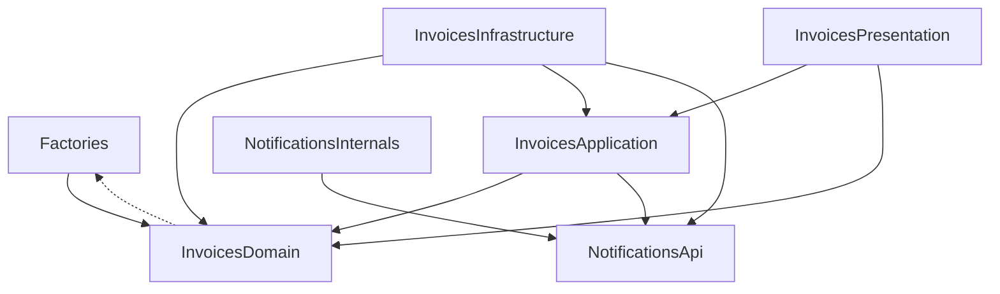

# Solution

The Invoices module (`src/Modules/Invoices`) adds three endpoints (create, show and send an invoice) and listens to the delivery webhook of the provided Notifications module, which moves a sent invoice to `sent-to-client`. The rules live on the domain models, every write runs in one transaction, and every failure answers a defined status with the invoice in a known state.

Where to find what the task is evaluated on:

- **Architecture and module boundaries:** [Module layout](#module-layout), [Decisions](#decisions)
- **Testing strategy:** [Testing strategy](#testing-strategy)
- **When things do not go as expected:** [Failure behaviour](#failure-behaviour), [What the send ordering costs](#what-the-send-ordering-costs), [Known limitations](#known-limitations)

Each decision links the pull request where it was made and reviewed.

## Module layout

```
src/Modules/Invoices/
├── Domain/          models that own every rule and both status transitions;
│                    StatusEnum; exceptions that know nothing about HTTP
├── Application/     one service per use case (create, find, send, mark
│                    delivered), each with a single handle(); readonly DTOs;
│                    NotificationFailed and SendNotRecorded
├── Infrastructure/  service provider, the webhook listener, the exception
│                    to HTTP status map
└── Presentation/    controller (one service call per action), form request
                     and its length rule, JSON resources, routes
```

Layer names mirror the Notifications module. There is no `Api/` folder because nothing outside the module consumes it. The listener sits in Infrastructure: it is glue to another module's event. `app/` holds only framework glue that names no module: the runtime guards (strict Eloquent outside production, no destructive database commands in production), `App\Database\SQLiteConnection` and `App\Exceptions\DatabaseLockedRenderer` (decisions 7 and 9).

SQLite is the project's only database, and the design targets it alone: `config/database.php` keeps only the `sqlite` connection, and decisions 3, 7 and 9 answer SQLite's locking. ([#11])

Allowed dependencies, enforced by Deptrac (from `deptrac analyse --formatter=mermaidjs`, without its use counts). Invoices reaches Notifications only through its `Api`. The dotted arrow is allowed too, but the models name their factories only in the `@use HasFactory<…>` PHPDoc, which Deptrac does not count:



## Decisions

1. **Eloquent models are the domain.** `Invoice` and `InvoiceProductLine` carry the rules; the services use them directly. Why: for one aggregate on a fixed schema, a repository would only forward to Eloquent. Instead of: repository interfaces with Eloquent implementations. ([#2])
2. **Every rule and both transitions live on the models.** A new invoice is always `draft` (the default; a `creating` listener rejects any other status), lines are checked on create and update, a direct write to `status` is rejected, and `markAsSending()` runs the send rule itself. The one rule a caller invokes is the total check (`ensureTotalFits()`), which the create service calls and the send rule repeats. Why: no caller can skip a line or status rule or put an invoice in a state the README forbids. Instead of: rules in the form request or the services. ([#2], [#9])
3. **Transitions are atomic conditional updates.** `UPDATE … SET status = 'sending' WHERE id = ? AND status = 'draft'`: zero affected rows means another request won, so 409 and no email. `sending → sent-to-client` works the same way. Why: SQLite compiles `lockForUpdate()` to nothing, so a row lock would silently not exist. Instead of: `lockForUpdate()`. ([#9])
4. **Strict services, tolerant listener.** The services throw. Only `WebhookDeliveredListener` catches "unknown invoice" and "not in `sending`", logs a warning with the id and the reason, and returns. Why: the webhook belongs to the provider and must not fail because of the invoice's state, while the services stay reusable. Instead of: services that swallow errors, or a webhook that answers 4xx. ([#14])
5. **Notify inside the transaction, then commit.** Claim `draft → sending`, call `NotificationFacadeInterface::notify()`, commit. A throwing notification rolls the claim back. Why: a committed `sending` then means the notification went out, which is the README's "change the status after sending". Instead of: committing the claim first and compensating with `sending → draft`, or an outbox (queued notifications are out of scope). ([#12])
6. **A failed notification answers 503.** `NotificationFailed` wraps any throwable from the facade, `\Error` included. The body says the invoice remains in draft and the send can be retried; the driver's own message never reaches the client. Why: 503 tells the client to retry. Instead of: Laravel's 500. ([#12], [#16])
7. **Transactions begin `IMMEDIATE` with a 5 s busy timeout.** The write lock is taken at `BEGIN`, so a concurrent send waits, then reads `sending` and gets a clean 409. `SQLiteConnection` rolls back a transaction whose `COMMIT` failed (SQLite keeps it open), which releases the lock. Why: under SQLite's default `DEFERRED` mode, a transaction that read before it wrote failed at once with "database is locked", because SQLite does not wait to upgrade a read lock. Instead of: `DEFERRED` transactions. ([#13])
8. **A failure after the notification is its own 500.** Once `notify()` has returned, only the commit is left. If the commit fails, `SendNotRecorded` answers a reported 500 that says the customer was notified, the invoice remains in draft and sending it again notifies them again. Why: the retryable 503 must only ever mean that nothing happened. Instead of: a warning in the documentation next to a 503. ([#16])
9. **A database lock answers 503 on every `/api` route.** `DatabaseLockedRenderer` recognises SQLite's result codes 5 and 6 (busy, locked), never the message, because a query error's message contains the client's own input. Why: a request that waits past the timeout fails at `BEGIN`, before it writes anything; a commit that fails on the lock is rolled back (decision 7; for a send, decision 8 applies); and responses are rendered from data already loaded, so nothing is read after a commit. The 503 is therefore safe to retry. Instead of: a reported 500, or a 503 on send only. ([#16])
10. **Create reads the JSON body only.** Form bodies and query parameters are ignored (a form-encoded request answers 422), amounts must be JSON integers (`integer:strict`), and a malformed body validates as empty. Why: one input format with exact types, and bytes that are not UTF-8 never reach the database. Instead of: Laravel's default merge of query, form and JSON input. ([#15])

## Testing strategy

Each test sits at the layer that owns the behaviour and runs on a real SQLite engine (in memory, or a temporary file where locks matter). Apart from the notification facade, little is replaced.

- **Models** (`tests/Unit/Invoice/Models`): every rule and transition: draft-only creation, the line invariant on raw values and at its bounds, totals and their overflow, the send rule's order of checks, each transition from every status, and the rejected direct status write. The atomic claim stands in for a concurrency test: two instances of the same invoice claim it, the stale second one's conditional update hits zero rows and throws, and the row moves once.
- **Services** (`tests/Unit/Invoice/Services`, `Listeners`): the orchestration with a fake facade. Nothing is notified when a rule fails, the invoice is draft after a failed notification, a failure after `notify()` becomes `SendNotRecorded`, and the delivery runs in its own transaction. For the listener: the exact warning, and that an unexpected error propagates.
- **HTTP** (`tests/Feature/Invoice/Http`, `DeliveryWebhookTest`): the contract, validation (each 422 leaves nothing stored), exact error bodies, and the real webhook route with real event dispatch and no `Event::fake`, so a missing listener registration fails.
- **Lifecycle** (`InvoiceLifecycleTest`): three end-to-end stories through the real routes, with only the facade faked (the log is a spy and reported exceptions are captured, so the tests can assert on them): the happy path delivered with the reference taken from the recorded notification, a delivery before the send, and a retry after a failed notification. Each step is read back through show.
- **Real locks** (`SqliteTransactionsTest`, `DatabaseLockedTest`): separate connections on a temporary file prove that `IMMEDIATE` waits at `BEGIN` and that a failed commit is rolled back and releases the lock. Over HTTP they produce the busy 503 with nothing written, and the not-recorded 500 behind a reader.
- **API contract:** every response of a documented operation in the feature tests is checked against `api.json` (Spectator). The only ones left out are two requests to paths no route matches and show's 500 for corrupt data, which the document does not describe. Its response objects are closed, so an undocumented field fails, which `ClosedResponseSchemasTest` proves. `OpenApiDocumentTest` fails on a stale document, and `OpenApiLinksTest` checks the links the fuzzer follows.
- **Architecture:** phpat rules (classes `final`, DTOs `readonly`, one public `handle()` per service, Domain depends only on itself, Eloquent, its factories and PHP) and the Deptrac map, both static.
- **Mutation testing:** Infection kills every mutant on the module and `app/` (100% covered MSI). Covered MSI does not count code that no test runs.
- **Fuzzing** (by hand, not in the suite): Schemathesis generates requests from `api.json`. It found one mismatch, a length limit checked after trimming, which was fixed ([#19]).

## Failure behaviour

| Condition | HTTP | Invoice afterwards | Test |
|---|---|---|---|
| **Create** `POST /api/invoices` | | | |
| `customer_name` or `customer_email` missing or invalid; a line without a name, or with a quantity or unit price outside 1 to 2,147,483,647 or not a JSON integer; `product_lines` not a list | 422 | nothing stored | [`CreateInvoiceTest`] |
| No `product_lines`, or `[]` (allowed by the task) | 201 | `draft` without lines; a send answers 422 | [`CreateInvoiceTest`] |
| A form body, a body not marked as JSON, malformed JSON | 422 | nothing stored | [`CreateInvoiceTest`] |
| More than 1000 lines | 422, one error, lines not validated | nothing stored | [`CreateInvoiceTest`] |
| Lines whose total overflows PHP's int | 422 on `product_lines` | nothing stored | [`CreateInvoiceTest`] |
| A customer name, email or line name over 255 characters as sent, even if trimming would shorten it | 422 | nothing stored | [`CreateInvoiceTest`] |
| **Show** `GET /api/invoices/{id}` | | | |
| Unknown id | 404 | – | [`ShowInvoiceTest`] |
| Not a uuid | 404, JSON whatever the `Accept` header | – | [`ShowInvoiceTest`] |
| Stored lines whose total overflows (written past the create service) | 500, reported | unchanged | [`ShowInvoiceTest`] |
| **Send** `POST /api/invoices/{id}/send` | | | |
| Unknown id | 404 | – | [`SendInvoiceTest`] |
| Invoice in `sending` or `sent-to-client` | 409 | unchanged | [`SendInvoiceTest`] |
| Second send of the same invoice | 409, one notification in total | `sending` | [`SendInvoiceTest`] |
| No lines, an invalid stored line, a total that overflows | 422 | `draft`, nothing notified | [`SendInvoiceTest`] |
| The notification throws (an exception or an `\Error`) | 503, `NotificationFailed`'s message only | `draft` | [`SendInvoiceTest`], [`InvoiceLifecycleTest`] |
| The commit fails after the notification | 500, reported; sending again notifies again | `draft` | [`DatabaseLockedTest`] |
| **Delivery webhook** `GET /api/notification/hook/delivered/{id}` | | | |
| Invoice in `sending` | 204 | `sent-to-client` | [`DeliveryWebhookTest`] |
| Invoice in `draft` (delivery before the send) | 204, warning logged | `draft` | [`DeliveryWebhookTest`], [`InvoiceLifecycleTest`] |
| Duplicate delivery | 204, warning logged | `sent-to-client` | [`DeliveryWebhookTest`] |
| Unknown invoice | 204, warning logged | – | [`DeliveryWebhookTest`] |
| **Any `/api` route** | | | |
| The database stays locked past the 5 s busy timeout | 503, nothing written, retryable | unchanged | [`DatabaseLockedTest`] (create, send), [`DatabaseLockedRendererTest`] (any `/api` path) |

Every error is JSON (`{"message": ...}`, plus `errors` for a 422), whatever the `Accept` header.

## What the send ordering costs

Decision 5 was confirmed knowing these consequences:

- SQLite's database-wide write lock is held from `BEGIN` until the commit, so other writers wait while `notify()` runs. The provided `DummyDriver` returns at once.
- A concurrent second send waits, then gets 409. If the wait runs out it fails at `BEGIN` with the busy 503. Either way it never notifies.
- A delivery report that arrives before the send commits waits at `BEGIN`, because the delivery runs in a transaction too, and then moves the invoice to `sent-to-client`. If it waits past the timeout, the webhook answers 503 and the provider can retry.
- A commit that fails after the notification leaves the invoice in draft and answers the not-recorded 500 (decision 8). `SQLiteConnection` rolls such a commit back at once, so the lock is released.
- A failed notification does not tell whether the email arrived. A provider that delivers and then throws gets its send rolled back, and a retry sends a duplicate. `NotifyData` carries the invoice uuid as its reference, which a real provider can deduplicate on.

## Known limitations

- The delivery webhook the task provides is an unsigned, unauthenticated GET in the Notifications module, which stays unchanged. Anyone who knows an invoice id can report a `sending` invoice delivered (the customer gets the id in the email's subject and body), and as a GET it is triggered by anything that follows the URL, such as a crawler or a link prefetcher. A real provider would sign its reports with an HMAC header or a signed route, ideally on a POST.
- An invoice whose delivery report never arrives stays in `sending`: there is no timeout, resend or reset, and every further send answers 409 (retried and queued notifications are out of scope).
- The invoice endpoints have no authentication or rate limiting (out of scope).
- Totals are integers in minor units up to 2^63−1, so a client must parse integers above 2^53 exactly. JavaScript's `JSON.parse` rounds them; use a BigInt-aware parser.
- Quiet saves (`saveQuietly()`, `createQuietly()`) and query-builder writes bypass the model rules, and the schema is fixed by the task, so there is no CHECK constraint behind them. The send rule re-checks the stored line amounts, so an invalid line written that way cannot be sent.
- Product lines stay editable through the model after the invoice leaves draft. No endpoint edits them, but nothing freezes them either.

## Running the checks

Set up with `./start.sh` as the README says. The commands run through Laravel Sail; `docker compose exec -u sail app php artisan test` and `docker compose exec -u sail app composer phpstan` do the same (`-u sail` runs them as the app's user, as Sail does, instead of root). oasdiff and Schemathesis run on the host, because they need Docker.

| Command | What it checks | Note |
|---|---|---|
| `vendor/bin/sail artisan test` | the test suite | in-memory SQLite; never touches `database/database.sqlite` |
| `vendor/bin/sail composer phpstan` | PHPStan at level max with Larastan, strict, deprecation, dead-code and disallowed-call rules (no debug output, no hand-written SQL), PHPUnit rules, 100% native type coverage, Type Perfect and the phpat rules | wipes its tmpDir first: under Docker Desktop its directory cache missed new files and still reported OK. The baseline is empty, and the three ignores in `phpstan.neon` are structural and commented |
| `vendor/bin/sail bin rector process --dry-run` | Rector with the PHP-version, dead-code, code-quality, coding-style, type-declaration, privatization, PHPUnit and Laravel sets | `rector.php` documents every skipped set and rule |
| `vendor/bin/sail composer deptrac` | the layer and module map above | |
| `vendor/bin/sail composer infection` | mutation testing at 100% covered MSI | two ignores, each reasoned in `infection.json5` |
| `vendor/bin/sail composer deps:validate`, `deps:audit`, `deps:analyse` | strict `composer.json`, security advisories, packages used but not declared, and declared in `require` but unused | the audit ignores one abandoned dev package (needs Composer 2.10 or newer; Sail ships 2.10.3). The analyser's ignores are reasoned in `composer-dependency-analyser.php` |
| `vendor/bin/sail composer taint` | Psalm taint analysis only (types stay with PHPStan) | it does not track `$request->string()` or route arguments; the `{invoice}` route only matches a uuid |
| `vendor/bin/sail composer api:export` | regenerates `api.json` | `OpenApiDocumentTest` fails when it is stale |
| `git show main:api.json \| docker run --rm -i -v "$PWD":/repo:ro -w /repo tufin/oasdiff:v1.33.0 breaking - api.json --fail-on ERR` | breaking API changes against `main` | |

**API contract.** `api.json` is the OpenAPI document Scramble generates from the code. It is committed, and the docs UI at `/docs/api` works in the local environment. Five dev-only Scramble extensions in `tests/Support/OpenApi` (registered in `config/scramble.php`) document what Scramble cannot infer:
- the mapped exceptions' responses and `total_price` as an integer ([#15]);
- the busy 503 on every operation ([#16]);
- OpenAPI links from create to show and send, and from send to show and the delivery webhook ([#19]);
- `additionalProperties: false` on every response object ([#18]). Requests stay open, and maps keep their value schema.

The document describes production. `phpunit.xml` pins `APP_DEBUG=false`; with the development `.env`'s `APP_DEBUG=true`, the error bodies Laravel renders itself (a path no route matches, an unexpected 500) also carry `exception`, `file`, `line` and `trace`, which the closed document does not allow. The module's own errors, the validation 422 and the busy 503 stay `{message}` either way. Because responses are closed, a new response field needs a regenerated document, and a client that validates strictly against the old one would reject it. oasdiff reports such a field as information, not as a breaking change.

**Fuzzing.** Run [Schemathesis](https://schemathesis.readthedocs.io) by hand, with Sail up, in two terminals. First, a second server with debug off on a throwaway SQLite file (stop it with Ctrl+C). A cached config (`bootstrap/cache/config.php`) would make it ignore these variables, so run `vendor/bin/sail artisan config:clear` first if you ever cached it:

```bash
vendor/bin/sail bash -c 'export DB_DATABASE=/tmp/fuzz-api.sqlite && rm -f "$DB_DATABASE"* && touch "$DB_DATABASE" && php artisan migrate --force && APP_DEBUG=false LOG_CHANNEL=stderr exec php artisan serve --host=127.0.0.1 --port=8001 --no-reload'
```

Then the fuzzer, in the app container's network:

```bash
docker run --rm --network "container:$(docker compose ps -q app)" -v "$PWD/api.json:/app/api.json:ro" -v "$PWD/schemathesis.toml:/app/schemathesis.toml:ro" schemathesis/schemathesis:4.32.5 --config-file schemathesis.toml run api.json
```

No seed is pinned, so each run explores new data. Schemathesis prints the seed it used, and `--seed <seed>` replays it. `schemathesis.toml` explains two exceptions:
- 422 counts as an accepted answer to data the document allows, for the rules it cannot express: text that is empty after trimming, a total that overflows, a send without lines.
- The QUERY method is left out, because PHP's built-in server answers it 501 before the request reaches Laravel.

The runs that closed the fuzzing work found no server error and no response outside the document; seed 1 reached send 200 ×38 and the webhook 204 ×18. Their one finding, the 255-character limit applied after trimming, was fixed first ([#19]).

## Try it

The API takes JSON only. Send the create body with `Content-Type: application/json`; a form-encoded request answers 422.

```bash
RESPONSE=$(curl -s http://localhost/api/invoices \
  -H 'Content-Type: application/json' \
  -d '{"customer_name": "Jane Doe", "customer_email": "jane@example.com",
       "product_lines": [{"name": "Consulting", "quantity": 2, "unit_price": 15000},
                         {"name": "Hosting", "quantity": 3, "unit_price": 100}]}')
echo "$RESPONSE"
# 201, status "draft"

INVOICE=$(echo "$RESPONSE" | sed -E 's/.*"data":[{]"id":"([^"]*)".*/\1/')

curl -s -X POST http://localhost/api/invoices/$INVOICE/send
# 200, status "sending"; sending again answers 409

curl -s -o /dev/null -w '%{http_code}\n' http://localhost/api/notification/hook/delivered/$INVOICE
# 204: the DummyDriver calls nothing, so this stands in for the provider's delivery report

curl -s http://localhost/api/invoices/$INVOICE
```

```json
{
  "data": {
    "id": "01a1795a-b62d-70e1-b3b9-9e89aa69b434",
    "status": "sent-to-client",
    "customer_name": "Jane Doe",
    "customer_email": "jane@example.com",
    "product_lines": [
      { "id": "01a1795a-b633-7337-8cad-c70d9ba30e32", "name": "Consulting", "quantity": 2, "unit_price": 15000, "total_unit_price": 30000 },
      { "id": "01a1795a-b633-7337-8cad-c70d9ba6d87b", "name": "Hosting", "quantity": 3, "unit_price": 100, "total_unit_price": 300 }
    ],
    "total_price": 30300
  }
}
```

The README's `ResourceDeliveredEvent` is `WebhookDeliveredEvent` in the provided Notifications module, which was left unchanged apart from Pint's formatting of one empty method body in `DummyDriver`.

[#2]: https://github.com/xc26gsnck4-creator/interview_3/pull/2
[#9]: https://github.com/xc26gsnck4-creator/interview_3/pull/9
[#11]: https://github.com/xc26gsnck4-creator/interview_3/pull/11
[#12]: https://github.com/xc26gsnck4-creator/interview_3/pull/12
[#13]: https://github.com/xc26gsnck4-creator/interview_3/pull/13
[#14]: https://github.com/xc26gsnck4-creator/interview_3/pull/14
[#15]: https://github.com/xc26gsnck4-creator/interview_3/pull/15
[#16]: https://github.com/xc26gsnck4-creator/interview_3/pull/16
[#18]: https://github.com/xc26gsnck4-creator/interview_3/pull/18
[#19]: https://github.com/xc26gsnck4-creator/interview_3/pull/19
[`CreateInvoiceTest`]: tests/Feature/Invoice/Http/CreateInvoiceTest.php
[`ShowInvoiceTest`]: tests/Feature/Invoice/Http/ShowInvoiceTest.php
[`SendInvoiceTest`]: tests/Feature/Invoice/Http/SendInvoiceTest.php
[`DatabaseLockedTest`]: tests/Feature/Invoice/Http/DatabaseLockedTest.php
[`DeliveryWebhookTest`]: tests/Feature/Invoice/DeliveryWebhookTest.php
[`InvoiceLifecycleTest`]: tests/Feature/Invoice/InvoiceLifecycleTest.php
[`DatabaseLockedRendererTest`]: tests/Unit/Exceptions/DatabaseLockedRendererTest.php
