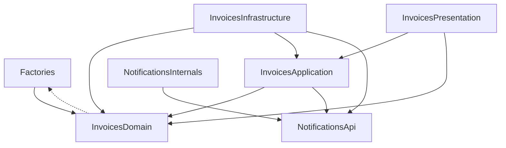

# Solution

The Invoices module (`src/Modules/Invoices`) adds three endpoints (create, show and send an invoice) and listens to the delivery webhook of the provided Notifications module, which moves a sent invoice to `sent-to-client`. The rules live on the domain models, every write runs in one transaction, and every failure answers a defined status with the invoice in a known state.

Where to find what the task is evaluated on:

- **Architecture and module boundaries:** [Module layout](#module-layout), [Decisions](#decisions)
- **Testing strategy:** [Testing strategy](#testing-strategy)
- **When things do not go as expected:** [Failure behaviour](#failure-behaviour), [What the send ordering costs](#what-the-send-ordering-costs), [Known limitations](#known-limitations)

Each decision links the pull request where it was made and reviewed.

## Module layout

```
src/Modules/Invoices/
├── Domain/          models that own every rule and both status transitions;
│                    Amount, the value object behind the line amounts;
│                    InvoiceStatus; exceptions that know nothing about HTTP
├── Application/     one service per use case (create, find, send, mark
│                    delivered), each with a single handle(); readonly DTOs;
│                    NotificationFailed
├── Infrastructure/  service provider, the webhook listener, the exception
│                    to HTTP status map
└── Presentation/    controller (one service call per action), form request,
                     JSON resources, routes
```

Layer names mirror the Notifications module. There is no `Api/` folder because nothing outside the module consumes it. The listener sits in Infrastructure: it is glue to another module's event. `app/` holds only framework glue that names no module: `AppServiceProvider`, which makes Eloquent strict outside production.

SQLite is the project's only database, and the design targets it alone: `config/database.php` keeps only the `sqlite` connection, and decisions 3, 7 and 8 answer SQLite's locking. ([#11])

Allowed dependencies, drawn by hand. phpat rules that PHPStan runs (`tests/Architecture/InvoicesArchitectureRules.php`) keep the Invoices layers pointing inwards, let only Application and Infrastructure reach Notifications, through its `Api`, keep Notifications from depending on Invoices, let only the Domain name the factories, and keep `app/` (not drawn) apart from the modules and the factories. Not checked: the arrows inside the Notifications module, the factories' arrows into the modules, and `routes.php`, which is not a class. The models name their factories only in the `@use HasFactory<…>` PHPDoc, hence the dotted arrow:



## Decisions

1. **Eloquent models are the domain.** `Invoice` and `InvoiceProductLine` carry the rules; the services use them directly. Why: for one aggregate on a fixed schema, a repository would only forward to Eloquent. A second aggregate, a second store or a rule that must run without the database would change that. Instead of: a repository interface declared in the Domain, an Eloquent implementation in Infrastructure over the models moved there, a mapper to plain entities, and Eloquent dropped from the Domain's phpat rule. Today that would be an interface, an implementation, a mapper and two entities over the same two tables. ([#2], [#32])
2. **Every rule and both transitions live on the models.** A new invoice is always `draft` (the default; a `creating` listener rejects any other status), quantity and unit price are `Amount` value objects that Eloquent's cast builds at assignment from the value as given, so a fraction or a numeric string is rejected instead of truncated, and `markAsSending()` runs the send rule itself. The one rule a caller invokes is the total check: the create service computes `totalPrice()` over the lines it has just stored, and an overflow rolls the invoice back. Create is the only endpoint that stores lines, so the send rule does not repeat it. Why: no service can create an invoice outside draft, store an invalid line or send an invoice the README forbids sending. Instead of: rules in the form request or the services. ([#2], [#9], [#30], [#34])
3. **Transitions are atomic conditional updates.** `UPDATE … SET status = 'sending' WHERE id = ? AND status = 'draft'`: zero affected rows means another request won, so 409 and no email. `sending → sent-to-client` works the same way. Why: SQLite compiles `lockForUpdate()` to nothing, so a row lock would silently not exist. Instead of: `lockForUpdate()`. ([#9])
4. **Strict services, tolerant listener.** The services throw. Only `WebhookDeliveredListener` catches "unknown invoice" and "not in `sending`", logs a warning with the id and the reason, and returns. Why: the webhook belongs to the provider and must not fail because of the invoice's state, while the services stay reusable. Instead of: services that swallow errors, or a webhook that answers 4xx. ([#14])
5. **Notify inside the transaction, then commit.** Claim `draft → sending`, call `NotificationFacadeInterface::notify()`, commit. A throwing notification rolls the claim back. Why: a committed `sending` then means the notification went out, which is the README's "change the status after sending". Instead of: committing the claim first and compensating with `sending → draft`, or an outbox (queued notifications are out of scope). ([#12])
6. **A failed notification answers 503.** `NotificationFailed` wraps any throwable from the facade, `\Error` included. The body says the invoice remains in draft and the send can be retried; the driver's own message never reaches the client. Why: 503 tells the client to retry. Instead of: Laravel's 500. ([#12], [#16])
7. **Transactions begin `IMMEDIATE` with a 5 s busy timeout.** The write lock is taken at `BEGIN`, so a concurrent send waits, then reads `sending` and gets a clean 409. Why: under SQLite's default `DEFERRED` mode, a transaction that read before it wrote failed at once with "database is locked", because SQLite does not wait to upgrade a read lock. Instead of: `DEFERRED` transactions. ([#13])
8. **A lock past the busy timeout answers Laravel's 500.** A request that waits longer than 5 s fails at `BEGIN`, before it writes anything, and the framework's handler answers a reported 500 on any route; a commit that fails on the lock answers the same 500 (for a send, see [What the send ordering costs](#what-the-send-ordering-costs)). It is Laravel's default, so it has no test of its own. Why: SQLite keeps a transaction whose commit failed open until the request's connection closes (one connection per request under `php artisan serve` and php-fpm), which rolls it back and releases the lock, and the README's failure criterion is the send and delivery workflow, which decisions 5 and 6 answer. Instead of: a 503 for SQLite's busy codes, a connection that rolls back a failed commit at once and a dedicated 500 for a send that notified but did not commit (built in [#13] and [#16]). ([#28])
9. **Create reads the JSON body only.** Form bodies and query parameters are ignored (a form-encoded request answers 422), amounts must be JSON integers (`integer:strict`), and a malformed body validates as empty. Why: one input format with exact types, and bytes that are not UTF-8 never reach the database. Instead of: Laravel's default merge of query, form and JSON input. ([#15])

## Testing strategy

Each decision is tested in full at the layer that makes it, and each layer above keeps at most one case of it, which proves that the layer calls the rule and maps its result; the end-to-end lifecycle stories come on top and do not count as a layer. Decision 8 is the exception: Laravel's default 500 has no test of its own. The tests run on a real SQLite engine (in memory, or a temporary file where locks matter), and apart from the notification facade little is replaced.

- **Value objects** (`tests/Unit/Invoice/ValueObjects`): the bounds of an `Amount` and what is not one, on plain PHPUnit with no application booted.
- **Models** (`tests/Unit/Invoice/Models`): every rule and transition: draft-only creation, the line amounts through the cast (create, update, decrement), totals and their overflow, the send rule's order of checks, and each transition from every status. The atomic claim stands in for a concurrency test: two instances of the same invoice claim it, the stale second one's conditional update hits zero rows and throws, and the row moves once.
- **Services** (`tests/Unit/Invoice/Services`, `Listeners`): the orchestration with a fake facade. Nothing is notified when a rule fails, the invoice is draft after a failed notification (an `\Error` included), and the delivery runs in its own transaction. For the listener: the exact warning, and that an unexpected error propagates.
- **HTTP** (`tests/Feature/Invoice/Http`, `DeliveryWebhookTest`): status codes and response bodies, validation (each 422 leaves nothing stored), exact error bodies, and the real webhook route with real event dispatch and no `Event::fake`, so a missing listener registration fails.
- **Lifecycle** (`InvoiceLifecycleTest`): three end-to-end stories through the real routes, with only the facade faked (the log is a spy and reported exceptions are captured, so the tests can assert on them): the happy path delivered with the reference taken from the recorded notification, a delivery before the send, and a retry after a failed notification. Each step is read back through show.
- **Real locks** (`SqliteTransactionsTest`): two connections on a temporary file prove that a transaction waits at `BEGIN` while another connection writes and fails there, before its callback runs, once the busy timeout runs out; the default connection's timeout is 5 s.
- **API document:** `OpenApiDocumentTest` fails when `api.json` differs from what Scramble generates from the code, or when Scramble meets a type it cannot document.
- **Architecture:** phpat rules, static and run by PHPStan: classes `final`, DTOs `readonly`, one public `handle()` per service, Domain depends only on itself, Eloquent (its cast contracts included), the model factories and PHP, and the checked part of the layer and module map above.

## Failure behaviour

The Test column names the tests that check the response. Where a row lists several causes, they check one of them; every cause is tested in full where it is decided (see [Testing strategy](#testing-strategy)), except decision 8's 500, Laravel's default, marked –.

| Condition | HTTP | Invoice afterwards | Test |
|---|---|---|---|
| **Create** `POST /api/invoices` | | | |
| `customer_name` or `customer_email` missing or invalid; a line whose name is missing, blank or over 255 characters, or whose quantity or unit price is outside 1 to 2,147,483,647 or not a JSON integer; `product_lines` a non-blank string, an object not keyed `"0"`, `"1"`, …, or more than 1000 lines | 422 | nothing stored | [`CreateInvoiceTest`] |
| No `product_lines`, `null` or `[]` (allowed by the task), or a blank string (see [Known limitations](#known-limitations)) | 201 | `draft` without lines; a send answers 422 | [`CreateInvoiceTest`] |
| A form body, a body not marked as JSON, malformed JSON | 422 | nothing stored | [`CreateInvoiceTest`] |
| Lines whose total overflows PHP's int | 422 on `product_lines` | nothing stored | [`CreateInvoiceTest`] |
| **Show** `GET /api/invoices/{id}` | | | |
| Unknown id | 404 | – | [`ShowInvoiceTest`] |
| Not a uuid | 404, JSON whatever the `Accept` header | – | [`ShowInvoiceTest`] |
| **Send** `POST /api/invoices/{id}/send` | | | |
| Unknown id | 404 | – | [`SendInvoiceTest`] |
| Invoice in `sending` or `sent-to-client`, such as a second send | 409, nothing notified again | unchanged | [`SendInvoiceTest`] |
| No lines, an invalid stored line | 422 | `draft`, nothing notified | [`SendInvoiceTest`] |
| The notification throws (an exception or an `\Error`) | 503, `NotificationFailed`'s message only | `draft` | [`SendInvoiceTest`], [`InvoiceLifecycleTest`] |
| The commit fails after the notification | 500, reported; sending again notifies again | `draft` | – |
| **Delivery webhook** `GET /api/notification/hook/delivered/{id}` | | | |
| Invoice in `sending` | 204 | `sent-to-client` | [`DeliveryWebhookTest`] |
| Invoice in `draft` (delivery before the send) | 204, warning logged | `draft` | [`InvoiceLifecycleTest`] |
| Duplicate delivery | 204, warning logged | `sent-to-client` | [`DeliveryWebhookTest`] |
| Unknown invoice | 204, warning logged | – | [`DeliveryWebhookTest`] |
| **Any `/api` route** | | | |
| The database stays locked past the 5 s busy timeout (except a send's commit after the notification: the 500 above) | 500, reported, nothing written | unchanged | – |

Every error is JSON (`{"message": ...}`, plus `errors` for a 422), whatever the `Accept` header.

## What the send ordering costs

Decision 5 was confirmed knowing these consequences:

- SQLite's database-wide write lock is held from `BEGIN` until the commit, so other writers wait while `notify()` runs. The provided `DummyDriver` returns at once.
- A concurrent second send waits, then gets 409, or fails at `BEGIN` once the wait runs out. Either way it never notifies.
- A delivery report that arrives before the send commits waits at `BEGIN`, because the delivery runs in a transaction too, and then moves the invoice to `sent-to-client`. If the send rolls back instead, the report finds `draft` and is ignored with a warning (204).
- A commit that fails after the notification answers a 500, and the invoice is draft again once the request's connection closes (decision 8), so sending it again notifies the customer again.
- A failed notification does not tell whether the email arrived. A provider that delivers and then throws gets its send rolled back, and a retry sends a duplicate. `NotifyData` carries the invoice uuid as its reference, which a real provider can deduplicate on.

## Known limitations

- The delivery webhook the task provides is an unsigned, unauthenticated GET in the Notifications module, which stays unchanged. Anyone who knows an invoice id can report a `sending` invoice delivered (the customer gets the id in the email's subject and body), and as a GET it is triggered by anything that follows the URL, such as a crawler or a link prefetcher. A real provider would sign its reports with an HMAC header or a signed route, ideally on a POST.
- An invoice whose delivery report never arrives stays in `sending`: there is no timeout, resend or reset, and every further send answers 409 (retried and queued notifications are out of scope).
- The invoice endpoints have no authentication or rate limiting (out of scope).
- Totals are integers in minor units up to 2^63−1, so a client must parse integers above 2^53 exactly. JavaScript's `JSON.parse` rounds them; use a BigInt-aware parser.
- Query-builder writes bypass the model rules (a quiet save does not: the cast runs on assignment, not on an event), and the schema is fixed by the task, so there is no CHECK constraint behind them. The send rule re-checks the stored amounts as given, like the cast, so a line written that way with an amount that is not an integer from 1 to 2147483647 (a fraction or non-numeric text included; SQLite stores numeric text such as `'2'` as the integer 2) cannot be sent; show reads such a row through the cast and answers a reported 500, where the integer cast rendered a fraction as its integer part and text as 0. The cast checks only the value assigned, so the row can be repaired through the model (`update(['quantity' => 2])` stores 2), and a save that leaves the amounts alone (a rename) commits with the corrupt amount in place. `increment()` and `decrement()` check the new amount on the in-memory value while the SQL arithmetic runs on the stored one; no code path uses them. Lines added past the create service can also make the total overflow PHP's int; show and send then answer a reported 500, and the send's claim is rolled back, so the invoice stays `draft` and nothing is notified.
- Product lines stay editable through the model after the invoice leaves draft. No endpoint edits them, but nothing freezes them either.
- Assigning a stored invoice's `status` and calling `save()` is not stopped; the application changes the status only through the two transitions.
- Laravel decodes JSON objects into PHP arrays, trims strings and turns empty ones into `null` before the create rules run. For `product_lines`, `{}` reads as `[]`, an object keyed `"0"`, `"1"`, … as a list and a blank string as `null`. The rules check the trimmed text, while `api.json` describes the text as sent: a 255-character name after a tab breaks the document's `maxLength: 255` but is accepted and stored trimmed, and a blank name fits the document (no `minLength`) but answers 422.

## Running the checks

Set up with `./start.sh` as the README says. The commands run through Laravel Sail; any `composer` script below also runs as `docker compose exec -u sail app composer <script>` (`-u sail` runs it as the app's user, as Sail does, instead of root).

| Command | What it checks | Note |
|---|---|---|
| `vendor/bin/sail composer check` | the next three rows, top to bottom | stops at the first failing gate |
| `vendor/bin/sail composer lint` | code style: the Laravel preset plus `declare(strict_types=1)` in every `.php` file (`pint.json`) | |
| `vendor/bin/sail composer phpstan` | PHPStan at level max with Larastan, strict rules, PHPUnit rules and the phpat rules | wipes its tmpDir first: under Docker Desktop its directory cache missed new files and still reported OK. There is no baseline; the one ignore in `phpstan.neon` is structural and commented |
| `vendor/bin/sail composer test` | the test suite | in-memory SQLite, a temporary file for the lock tests; never touches `database/database.sqlite` |
| `vendor/bin/sail composer api:export` | regenerates `api.json` | `OpenApiDocumentTest` fails when it is stale, so `check` leaves it out |

**API document.** `api.json` is the OpenAPI document Scramble generates from the code. It is committed, and the docs UI at `/docs/api` works in the local environment. Two dev-only Scramble extensions in `tests/Support/OpenApi` (registered in `config/scramble.php`) document what Scramble cannot infer: the mapped exceptions' responses and `total_price` as an integer ([#15]). `APP_NAME`, `APP_URL` and `API_VERSION` reach the document, so `phpunit.xml` and `api:export` pin them. `phpunit.xml` also pins `APP_DEBUG=false`, so the tests see production's error bodies.

## Try it

The API takes JSON only. Send the create body with `Content-Type: application/json`; a form-encoded request answers 422.

```bash
RESPONSE=$(curl -s http://localhost/api/invoices \
  -H 'Content-Type: application/json' \
  -d '{"customer_name": "Jane Doe", "customer_email": "jane@example.com",
       "product_lines": [{"name": "Consulting", "quantity": 2, "unit_price": 15000},
                         {"name": "Hosting", "quantity": 3, "unit_price": 100}]}')
echo "$RESPONSE"
# 201, status "draft"

INVOICE=$(echo "$RESPONSE" | sed -E 's/.*"data":[{]"id":"([^"]*)".*/\1/')

curl -s -w '\n%{http_code}\n' -X POST http://localhost/api/invoices/$INVOICE/send
# 200, status "sending"

curl -s -w '\n%{http_code}\n' -X POST http://localhost/api/invoices/$INVOICE/send
# 409: the invoice is already sending

curl -s -o /dev/null -w '%{http_code}\n' http://localhost/api/notification/hook/delivered/$INVOICE
# 204: the DummyDriver calls nothing, so this stands in for the provider's delivery report

curl -s http://localhost/api/invoices/$INVOICE
```

```json
{
  "data": {
    "id": "01a1795a-b62d-70e1-b3b9-9e89aa69b434",
    "status": "sent-to-client",
    "customer_name": "Jane Doe",
    "customer_email": "jane@example.com",
    "product_lines": [
      { "id": "01a1795a-b633-7337-8cad-c70d9ba30e32", "name": "Consulting", "quantity": 2, "unit_price": 15000, "total_unit_price": 30000 },
      { "id": "01a1795a-b633-7337-8cad-c70d9ba6d87b", "name": "Hosting", "quantity": 3, "unit_price": 100, "total_unit_price": 300 }
    ],
    "total_price": 30300
  }
}
```

The README's `ResourceDeliveredEvent` is `WebhookDeliveredEvent` in the provided Notifications module, which was left unchanged apart from Pint's formatting of one empty method body in `DummyDriver`.

[#2]: https://github.com/xc26gsnck4-creator/interview_3/pull/2
[#9]: https://github.com/xc26gsnck4-creator/interview_3/pull/9
[#11]: https://github.com/xc26gsnck4-creator/interview_3/pull/11
[#12]: https://github.com/xc26gsnck4-creator/interview_3/pull/12
[#13]: https://github.com/xc26gsnck4-creator/interview_3/pull/13
[#14]: https://github.com/xc26gsnck4-creator/interview_3/pull/14
[#15]: https://github.com/xc26gsnck4-creator/interview_3/pull/15
[#16]: https://github.com/xc26gsnck4-creator/interview_3/pull/16
[#28]: https://github.com/xc26gsnck4-creator/interview_3/pull/28
[#30]: https://github.com/xc26gsnck4-creator/interview_3/pull/30
[#32]: https://github.com/xc26gsnck4-creator/interview_3/pull/32
[#34]: https://github.com/xc26gsnck4-creator/interview_3/pull/34
[`CreateInvoiceTest`]: tests/Feature/Invoice/Http/CreateInvoiceTest.php
[`ShowInvoiceTest`]: tests/Feature/Invoice/Http/ShowInvoiceTest.php
[`SendInvoiceTest`]: tests/Feature/Invoice/Http/SendInvoiceTest.php
[`DeliveryWebhookTest`]: tests/Feature/Invoice/DeliveryWebhookTest.php
[`InvoiceLifecycleTest`]: tests/Feature/Invoice/InvoiceLifecycleTest.php
